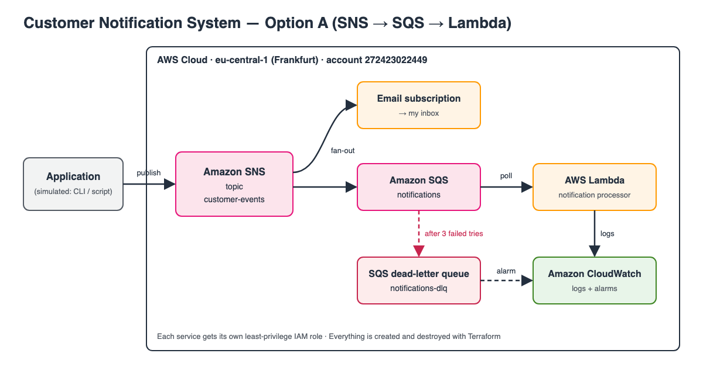

# Customer Notification System

DCI Cloud AWS final project. An online shop publishes one event, for example "order shipped", and AWS delivers it to every place that needs it. If something fails, nothing is lost.



## The problem

NotifyNow's app sends every notification itself. One broken channel can break an order, failed messages are lost, and every new notification type means changing the app.

**The idea:** the app only says "this happened". AWS does the rest. Events carry identifiers such as `orderId` and `customerId`, not customer names or email addresses.

## How it works

1. The app publishes an event to the SNS topic `customer-events`.
2. SNS sends a copy to an email address and to the SQS queue `notifications` (fan-out).
3. A Lambda reads the queue, checks the event and writes a log to CloudWatch.
4. If Lambda fails, SQS retries. After 3 failed tries the message moves to `notifications-dlq`.
5. A CloudWatch alarm on the dead-letter queue emails a person.

| AWS service | Role |
|---|---|
| SNS | Fan-out of events, and the alarm email |
| SQS | Queue with retries, plus a dead-letter queue |
| Lambda | Checks and logs each event (TypeScript, Node 22) |
| CloudWatch | Logs and the dead-letter queue alarm |
| IAM | Least-privilege role for the Lambda |
| Budgets | Email alert at $5 a month |

## What's in the repo

| Folder | Content |
|---|---|
| `terraform/` | All AWS resources |
| `lambda/` | The Lambda code (`src/handler.ts`) |
| `demo-ui/` | A small React page and Python server that play the shop app |
| `presentation/` | Slides and demo script |
| `architecture/`, `requirements/`, `notifications/`, `reliability/`, `monitoring/`, `security/`, `cost/`, `tests/` | Design docs and test results |

## Demo UI

`demo-ui/` plays the shop app, so the flow can be shown with buttons instead of CLI commands.

```
React page → server.py → aws sns publish → SNS → email + SQS → Lambda → CloudWatch Logs
     ↑                                                                    │
     └──── asks every 4 s ←── server.py searches the logs for the order ←─┘
```

- `frontend/`: React + TypeScript (Vite). One card per order, with a button and status dots.
- `server.py`: a small Python server on `localhost:8790`. It runs the AWS CLI for each button, and refuses to start if the profile points to the wrong account.
- Lambda never calls the page. The page asks the server, and the server reads the Lambda logs, the dead-letter queue and the alarm state.

## Run it

**You need:** an AWS account, the AWS CLI with a profile for it, Terraform 1.14+, Node 22+ and Python 3. Region: `eu-central-1`.

In every terminal you use, first set your profile and account:

```bash
export AWS_PROFILE=your-aws-profile
export AWS_ACCOUNT_ID=123456789012
export AWS_REGION=eu-central-1
```

### 1. Build the Lambda

```bash
cd lambda
npm ci
npm run build
cd ..
```

### 2. Create the AWS resources

```bash
cd terraform
cp example.tfvars terraform.tfvars
```

Edit `terraform.tfvars`:

```hcl
notification_email = "you@example.com"
aws_profile        = "your-aws-profile"
aws_account_id     = "123456789012"
```

```bash
terraform init
terraform apply
cd ..
```

AWS emails you 2 confirmation links (events and alarm). Click both, or no email arrives.

### 3. Start the demo page

```bash
cd demo-ui/frontend
npm install
npm run build
cd ..
python3 server.py
```

Open http://localhost:8790. The page has two orders:

- **A-2001, Ship order:** a good event. Both dots turn green, and the email arrives.
- **A-2002, Ship order:** a broken event with no customer ID. Lambda fails 3 times, the message lands in the dead-letter queue, and the alarm emails you after about 5 minutes.
- **Reset demo, Delete:** empties the dead-letter queue, so the alarm can fire again.

### Or test with the CLI only

Replace `<topic-arn>` with the `customer_events_topic_arn` that `terraform output` prints.

```bash
# Good event: email + Lambda log
aws sns publish --topic-arn <topic-arn> --message '{"type":"order.shipped","orderId":"A-2001","customerId":"C-2001"}'

# Broken event (no customerId): 3 tries, dead-letter queue, alarm email after about 5 minutes
aws sns publish --topic-arn <topic-arn> --message '{"type":"order.shipped","orderId":"A-2002"}'

# See the Lambda log
aws logs tail /aws/lambda/notification-lambda --since 10m
```

### Clean up

```bash
cd terraform
terraform destroy
```

## Next steps

- Duplicate check with DynamoDB
- Real customer emails, for example with SES
- Automatic deploys from GitHub Actions
