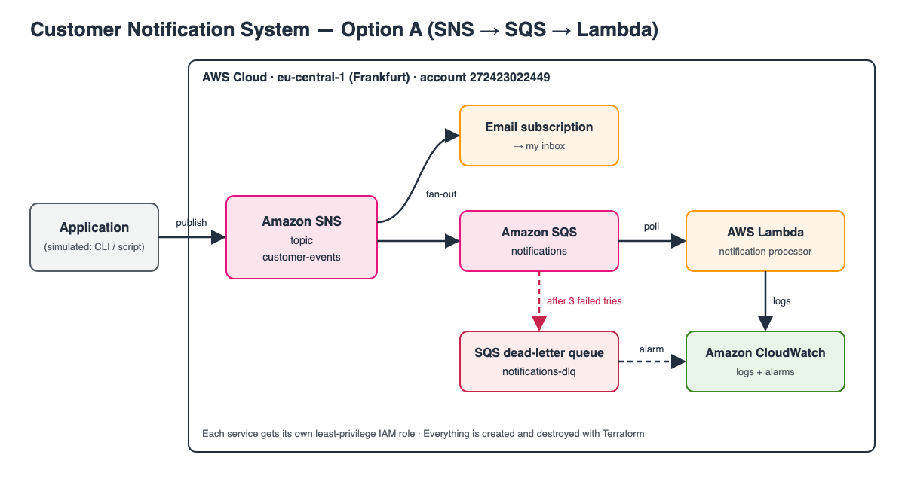

# Customer Notification System

Event-driven notification system on AWS for the DCI Cloud final project.
One business event is published once and fanned out to several independent
notification consumers (SNS → SQS → Lambda, with retries and a dead-letter queue).

## Project Overview



The app publishes an event once to an SNS topic. SNS fans it out to an email subscription and to an SQS queue, which a Lambda function processes. Messages that keep failing land in a dead-letter queue, and CloudWatch shows logs and alarms.

## Business Problem

NotifyNow's main app sends every email, SMS and internal message itself. That couples it to every channel: a slow or broken channel slows or breaks the app, and every new notification type means changing the app. Details in [architecture/current-architecture.md](architecture/current-architecture.md).

## Requirements

See [requirements/](requirements/).

## Architecture Options

See [architecture/architecture-options.md](architecture/architecture-options.md).

## Final Architecture

_TODO_

## AWS Services

_TODO_

## Architecture Decisions

See [architecture/architecture-decisions.md](architecture/architecture-decisions.md).

## Terraform

Infrastructure lives in [terraform/](terraform/). Every command uses the `dci` AWS profile:

```bash
cd terraform
terraform init
terraform plan
```

## Testing

See [tests/test-results.md](tests/test-results.md).

## Security

See [security/iam-design.md](security/iam-design.md).

## Cost Considerations

See [cost/cost-analysis.md](cost/cost-analysis.md).

## Limitations & Future Improvements

_TODO_

## Cleanup

```bash
cd terraform
terraform destroy
```
